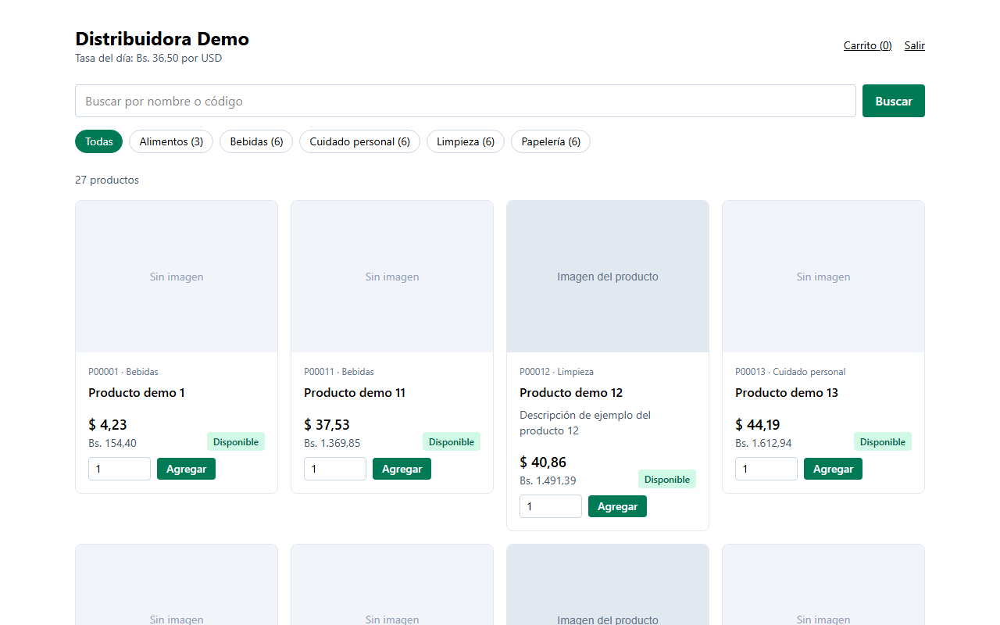
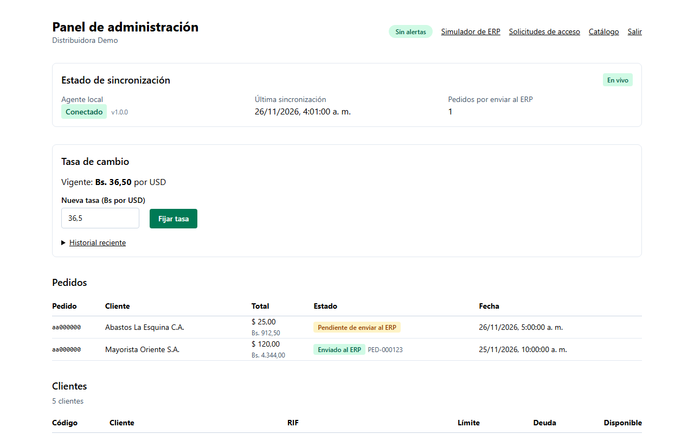
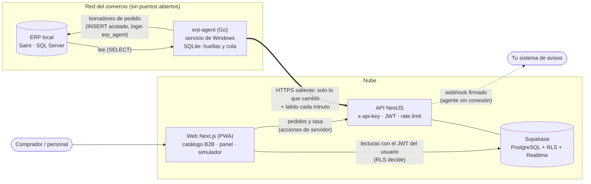
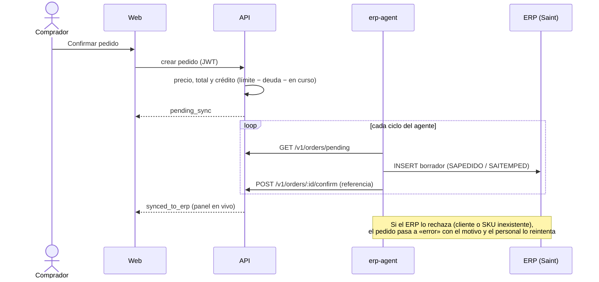
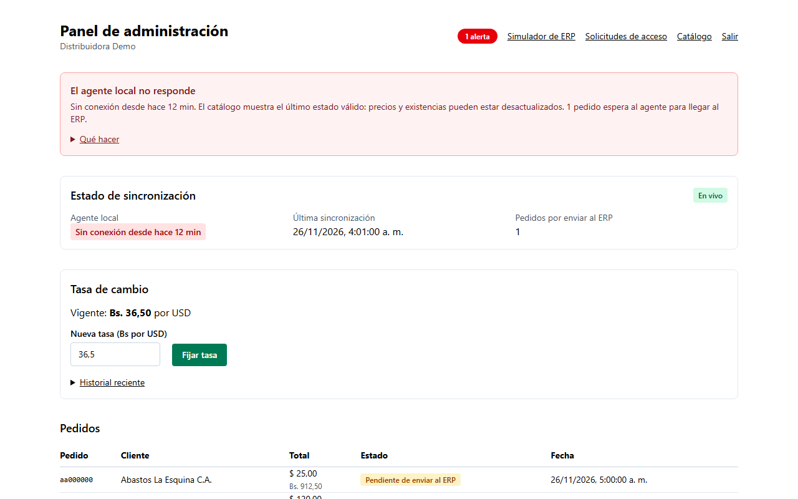

# erp-web-bridge

[](https://github.com/Pepitocrackking/erp-web-bridge/actions/workflows/ci.yml)

**Puente seguro entre el ERP local de un comercio (Saint Enterprise primero, Odoo después) y un catálogo web B2B multimoneda (USD y Bs).**

Un agente local escrito en Go lee el ERP y empuja los cambios por HTTPS hacia la nube. No abre puertos en el cliente, tolera cortes de luz e internet y **nunca escribe en tablas fiscales**: los pedidos web vuelven al ERP como borradores. En la nube, una API NestJS y Supabase (PostgreSQL con RLS y Realtime) alimentan un catálogo B2B instalable como PWA y un panel de administración que se actualiza en vivo.

Está pensado para pymes y distribuidoras de Venezuela y LATAM: ERP local en Windows, sin IP pública fija, cortes de luz frecuentes y doble moneda con tasa de cambio.

| Catálogo del comprador (USD y Bs) | Panel de administración en vivo |
|---|---|
|  |  |

## Arquitectura



**Cómo viaja un pedido** (de la web al ERP, sin tocar lo fiscal):



### Decisiones de diseño

- **Agente «solo saliente».** Nunca se abre un puerto en el router del cliente. Si cae internet o la luz, la web sigue con el último estado válido y el agente retoma sin perder nada (cola SQLite con escritura síncrona; probado con `kill -9`).
- **Sincronización diferencial por hash.** El agente guarda una huella SHA-256 de `sku + precio + stock + nombre` y solo envía lo que cambió; una reconciliación completa (diaria) detecta lo eliminado. Con 5.000 productos: ~0,4 s el alta y ~0,2 s un reenvío sin cambios.
- **Cero riesgo contable, en tres capas.** (1) Lista blanca en el código: solo `SELECT` y `INSERT` en las dos tablas del borrador; (2) un login SQL dedicado (`erp_agent`) sin permisos sobre lo fiscal, que el agente verifica al arrancar y, si puede escribir de más, **se niega a procesar pedidos**; (3) pruebas que comparan la huella de las tablas fiscales antes y después. Detalle en [docs/saint-sandbox.md](docs/saint-sandbox.md).
- **Multi-tenant con RLS.** Cada consulta del usuario corre con su JWT y PostgreSQL decide qué ve; el lado del agente filtra siempre por la organización de su `x-api-key`. 48 pruebas de RLS.
- **Multimoneda desacoplada.** El ERP guarda USD; la tasa vive en la nube y los Bs se calculan al mostrar, sin alterar los costos base. Una sola función de conversión compartida entre API y web.
- **Patrón Adapter.** El agente habla con el ERP mediante una interfaz; hoy `saint` (nombres de tablas y columnas en un archivo de mapeo, no en el código) y `mock` (demos sin ERP). `odoo` está en el backlog.

## Qué incluye

| Pieza | Qué hace |
|---|---|
| `packages/erp-agent` | Agente en Go (un `.exe` de ~18 MB sin dependencias). Sync delta, cola con reintentos y backoff, latido, pedidos hacia el ERP y **servicio de Windows** (`erp-agent service install`: arranque automático, reinicio ante fallo, log con rotación). |
| `apps/api` | NestJS: ingesta masiva idempotente, pedidos con validación de crédito, tasa de cambio, OpenAPI en `/docs`, JWT ES256/HS256, rate limiting y **aviso por webhook** si un agente deja de dar señales ([docs/agent-alerts.md](docs/agent-alerts.md)). |
| `apps/web` | Next.js 16 + Tailwind 4: catálogo B2B (búsqueda, categorías, precio por lista), carrito con crédito, panel de administración **en vivo** con alertas, simulador de ERP, solicitudes de acceso, **PWA** instalable con catálogo sin conexión. |
| `supabase/` | Migraciones SQL, RLS y seed con dos organizaciones. |
| `infra/saint-sandbox` | SQL Server 2022 en Docker que replica las tablas de Saint (`SAPROD`, `SAEXIS`, `SACLIE`, `SADEPO`, `SAINSTA`) con 311 productos y 48 clientes, para probar el adaptador de verdad. |

## Guion de demo (5 minutos)

Arranque con un comando: `pnpm demo` (ver [Probarlo en local](#probarlo-en-local)). Capturas de cada paso en [`docs/screenshots/`](docs/screenshots).

1. **Un clic, sin registro.** Abre `http://localhost:3100/login` y pulsa **«Entrar como Administrador Demo»**. Estás en el panel de la «Distribuidora Demo»: estado del agente, tasa del día, pedidos, clientes con su crédito y la bitácora de sincronización.
2. **El ERP cambia, la web lo refleja al instante.** En el panel abre **«Simulador de ERP»**: es la tabla de inventario de un ERP local. Cambia el precio o la existencia de un producto y pulsa **«Sincronizar con la nube»**. Los cambios viajan por la misma API de ingesta que usa el agente real, y solo se envía lo modificado.
3. **Dos pestañas.** En otra ventana entra como comprador (`cliente@demo-saint.test` / `demo1234`): el catálogo muestra el precio de su lista mayorista en USD y en Bs, y **cambia en vivo** cuando sincronizas en el paso 2, sin recargar.
4. **La tasa manda.** En el panel escribe una tasa nueva y pulsa **«Fijar tasa»**: todos los precios en Bs del catálogo se recalculan en vivo. El historial queda registrado.
5. **Un pedido con crédito.** Como comprador agrega productos al carrito. Verás el total en USD y Bs y **tu crédito disponible** (límite − deuda − pedidos en curso). Si el pedido lo supera, no se puede confirmar. Confirma uno: aparece en el panel como **«Pendiente de enviar al ERP»**.
6. **Del pedido al borrador del ERP** (el agente real y el sandbox de Saint ya los levantó `pnpm demo`). El agente lo recoge, lo deja como borrador en `SAPEDIDO` y el panel pasa a **«Enviado al ERP»** con la referencia, sin recargar. Si el ERP lo rechaza, el panel muestra el motivo y un botón **«Reintentar»**.
7. **Cuando algo falla.** Detén el agente (o espera 3 minutos sin latido): el panel muestra el banner **«El agente local no responde»** con un «Qué hacer», un contador en la cabecera y el número en el título de la pestaña. Con un webhook configurado, también llega el aviso a tu sistema.



## Probarlo en local

Requisitos: **Docker en marcha**, Node ≥ 24, pnpm ≥ 12 y Go ≥ 1.26 (solo para el agente; sin Go el demo arranca sin agente real).

```bash
git clone https://github.com/Pepitocrackking/erp-web-bridge.git && cd erp-web-bridge
pnpm demo
```

Un solo comando, igual en Windows, macOS y Linux. Desde un clon limpio instala las dependencias, levanta **Supabase local** (base de datos, Auth y Realtime) y el **sandbox de Saint** (SQL Server en Docker), compila, arranca la **API**, la **web en modo demo** y el **agente real**, y termina **comprobando el flujo completo** de verdad:

```
✔ agente conectado y sincronizado
✔ catálogo: 297 productos activos en la nube = 297 activos en SAPROD (Saint)
✔ pedido creado por el comprador → «Enviado al ERP» con la referencia PW0000002
✔ SAPEDIDO: existe exactamente 1 borrador de ese pedido (Estado = 'B')
✔ tablas fiscales (SAFACT, SAITEMFAC, SAACXC) intactas
Flujo completo verificado: pedido web → agente real → borrador en Saint → panel.
```

Tarda unos 4 minutos desde cero (la primera vez, además, Docker descarga imágenes). Al final imprime las URLs y los usuarios del guion de demo.

| Comando | Qué hace |
|---|---|
| `pnpm demo` | Levanta todo y verifica el flujo. Se puede repetir: reutiliza lo que ya esté en marcha. |
| `pnpm demo:stop` | Detiene API, web, agente, Supabase y Saint. Los datos se conservan. |
| `pnpm demo status` | Qué está corriendo. |
| `pnpm demo check` | Repite solo la verificación del flujo. |
| `pnpm demo --reset` | Además, restablece la base de Supabase al seed. |
| `pnpm demo --no-agent` | Sin agente real (si no tienes Go). |

Qué esperar: el agente carga en la organización demo los 311 productos y 48 clientes del sandbox de Saint (297 activos), así que el catálogo, los créditos y las existencias que ves son los del «ERP». Los logs están en `.demo/logs/`. Las pruebas E2E de Playwright esperan el seed original: tras un demo, corre `pnpm db:reset` antes de `pnpm e2e`.

`DEMO_MODE=true` habilita el botón de acceso demo y el simulador, y todo usa claves y contraseñas **públicas de desarrollo**: no lo uses en producción real ([docs/security.md](docs/security.md)). Para llevarlo a producción (imágenes Docker de la API y la web, Supabase en la nube) sigue [docs/deploy.md](docs/deploy.md). Más detalle en [docs/supabase-local.md](docs/supabase-local.md), [docs/saint-sandbox.md](docs/saint-sandbox.md) y [packages/erp-agent/README.md](packages/erp-agent/README.md).

<details>
<summary>Paso a paso, sin el comando <code>demo</code></summary>

```bash
pnpm install
grep '^NEXT_PUBLIC_' .env.example > apps/web/.env.local   # en PowerShell: Select-String
cp .env.example .env                                      # contraseña del sandbox de Saint
pnpm db:start && pnpm db:reset                            # Supabase local + migraciones y seed
bash scripts/saint-sandbox.sh up                          # SQL Server con las tablas de Saint (en Windows: scriptssaint-sandbox.ps1 up)
pnpm build
PORT=3001 node apps/api/dist/main.js                      # API
cd apps/web && DEMO_MODE=true pnpm exec next start -p 3100   # web
cd packages/erp-agent && cp agent.example.yaml agent.yaml    # api.api_key: erp_dev_demo_saint_key; dsn con el login erp_agent
CGO_ENABLED=0 go build -o erp-agent.exe ./cmd/erp-agent && ./erp-agent.exe -config agent.yaml
```

</details>

## Calidad

Cada fase se cerró con una compuerta de verificación con datos reales (evidencia en [`docs/evidence/`](docs/evidence)):

| Qué | Pruebas |
|---|---|
| Contratos compartidos (Zod) | 102 |
| API (la mayoría, de integración contra PostgreSQL real) | 209 |
| Web (unitarias) | 87 |
| RLS multi-tenant y guardas estructurales de seguridad | 53 |
| Agente Go (16 paquetes, con `-race`; incluye pruebas contra el SQL Server del sandbox) | `go test ./...` |
| E2E de punta a punta con Playwright (UI, Realtime, PWA, cabeceras de seguridad, agente real y sandbox de Saint) | 56 |

El CI (GitHub Actions) corre formato, lint, las pruebas de RLS y de TypeScript con una base Supabase real, el build, `gofmt`, `go vet`, build y pruebas del agente, y además el **escaneo de secretos en todo el historial** (gitleaks), `pnpm audit` y `govulncheck`, en cada PR. Las E2E de Playwright necesitan la pila completa y se corren a mano (`pnpm e2e` en `apps/web`).

## Seguridad

Revisión de claves, RLS y dependencias con sus hallazgos, lo que se corrigió y los riesgos que se aceptan (dichos sin rodeos): [docs/security.md](docs/security.md). Para reportar una vulnerabilidad: [SECURITY.md](SECURITY.md).

## Estructura

```
erp-web-bridge/
├── apps/
│   ├── api/                 # NestJS: ingesta, pedidos, tasa, alertas
│   └── web/                 # Next.js: catálogo, panel, simulador, PWA
├── packages/
│   ├── erp-agent/           # agente Go (adapters saint y mock, servicio de Windows)
│   └── shared-types/        # contratos Zod compartidos y conversión de moneda
├── supabase/                # migraciones, RLS, seed y pruebas de RLS
├── infra/saint-sandbox/     # SQL Server en Docker que replica tablas de Saint
├── scripts/                 # sandbox, validación y prueba del servicio de Windows
└── docs/                    # ROADMAP, evidencias por fase, guías y capturas
```

## Siguientes pasos (backlog v1)

`OdooAdapter` · scraper de la tasa BCV con respaldo manual · precios escalonados por volumen · notificaciones por WhatsApp · `ChrystalAdapter` · actualización automática del agente · validar el `SaintAdapter` contra una base real de un cliente piloto (los nombres de columnas son de mejor esfuerzo y viven en `infra/saint-sandbox/mapping.saint.yaml`).

El plan completo por fases está en [docs/ROADMAP.md](docs/ROADMAP.md).

## Licencia

[MIT](LICENSE) © 2026 Orlando Guerra.
